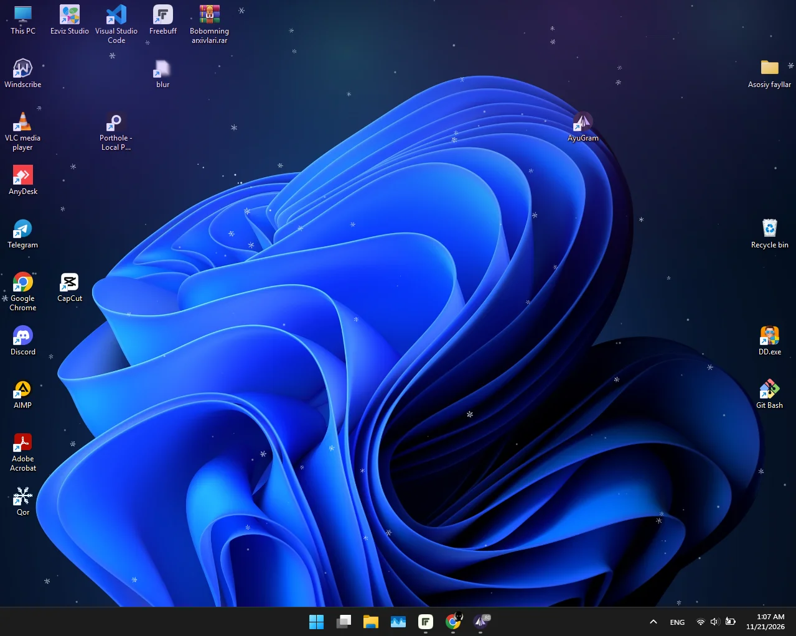
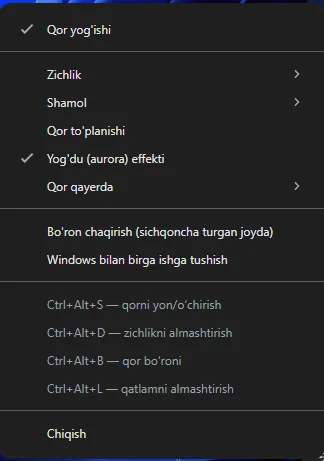

# ❄️ SNOWY DESKTOP

**Ish stoli orqasida yog'adigan interaktiv qor — o'yin paytida FPS'ni o'g'irlamaydi.**

Windows uchun Electron ilova: shaffof qor qatlami ish stolining eng orqa foniga (WorkerW/Progman) joylashadi, shuning uchun u ochiq oynalar va o'yinlar orqasida ko'rinadi, sichqoncha bosishlarini esa hech qachon to'smaydi.

---

## 🚀 Yuklab olish

| Platforma | Fayl | Havola |
| --- | --- | --- |
| **Windows 10/11** | `Qor-Setup-1.0.0.exe` (115 MB) | [Yuklab olish](https://github.com/shadow0072009-coder/SNOWY-DESKTOP/releases/download/v1.0.0/Qor-Setup-1.0.0.exe) |
| **Android 7.0+** | `Qor-1.0.0.apk` (29 KB) | [Yuklab olish](https://github.com/shadow0072009-coder/SNOWY-DESKTOP/releases/download/v1.0.0/Qor-1.0.0.apk) |

Barcha relizlar: [Releases](https://github.com/shadow0072009-coder/SNOWY-DESKTOP/releases).

### Yangiliklar (v1.0.0)

- **Android versiyasi** — qor endi telefonda ham: jonli fon rasmi (live wallpaper) sifatida ikonkalar orqasida yog'adi.
- README'ga haqiqiy ilova skrinshotlari qo'shildi (ish stoli qatlami va tray menyusi).
- Windows installer va Android APK bitta relizda.

---

## 📸 Skrinshotlar

**Qor ish stolining o'zida — ikonkalar va oynalar orqasida yog'adi, ustiga chizmaydi va bosishlarni to'smaydi:**



**Tray menyusi — zichlik, shamol, aurora, qatlam rejimi va hotkey'lar:**



---

## Xususiyatlar

- **Ish stoli qatlami** — qor oynalar *orqasida* turadi (Snowhush uslubi: `WorkerW`/`Progman`ga `SetParent`). Tray'dan `Overlay` rejimiga ham o'tish mumkin.
- **FPS tejamkor** — 30 fps (yoki 20 fps) cap, 1× piksel canvas, `desynchronized` kontekst, oldindan kesh qilingan gradientlar. O'yin paytida 150 → 30 fps tushishi tuzatilgan.
- **Qor "oq parda" emas** — gradientli fon yo'q: faqat qor parchalari, uyumlar, aurora, bo'ron. Pastdagi panel/interfeys to'silmaydi.
- **Har qanday resolution'ga avtomatik moslash** — barcha o'lchamlar `scale = clamp(min(W/1920, H/1080), 0.55, 2)` orqali proportsional hisoblanadi (1080p = 1×). Resolution almashtirilsa, oyna faqat `setBounds` bilan yangilanadi — qor uzilib qolmaydi. Monitor qo'shilsa/uzilsa qatlamlar qayta quriladi.
- **Boshqarish** — tray menyusi: qor zichligi (yengil / o'rtacha / kuchli), shamol, bo'ron, qatlam rejimi, pauza, autostart.
- **Global hotkey'lar** — qor va bo'ron uchun tezkor tugmalar (tray menyusida ko'rsatilgan).
- **Bir nechta monitor** — har bir displey uchun alohida qatlam.

## O'rnatish (foydalanuvchi uchun)

1. [`Qor-Setup-1.0.0.exe`](https://github.com/shadow0072009-coder/SNOWY-DESKTOP/releases/download/v1.0.0/Qor-Setup-1.0.0.exe) faylini yuklab oling.
2. Ikki marta bosing — bir bosishda o'rnatiladi (admin paroli kerak emas).
3. Ish stolida **Qor** yorlig'i paydo bo'ladi. Qor darhol ko'rinadi, ilova tray'da turadi.

O'chirish: **Settings → Apps → Qor → Uninstall**. Sozlamalar `%APPDATA%\qor-desktop\qor-settings.json` da saqlanadi.

> Installer imzolanmagan, shuning uchun Windows SmartScreen ogohlantirishi chiqishi mumkin: *More info → Run anyway*.

## Manbadan ishga tushirish

```bash
npm install
npm start
```

Diagnostika (headless smoke-test — qatlam, canvas, bo'ron, resize):

```bash
npx electron . --smoke
```

## Yig'ish

```bash
npm run setup   # dist-installer/Qor-Setup-<versiya>.exe  (NSIS installer)
npm run dist    # dist/Qor-win32-x64/  (portativ papka + ZIP)
```

## 📱 Android (live wallpaper)

`android/` papkasida Windows versiyaning Android porti: qor **jonli fon rasmi** (live wallpaper) sifatida ishlaydi — ikonkalar, papka va vidjetlar orqasida yog'adi, tegishlarni to'smaydi.

- Qor dvigateli `src/renderer/snow.js` dan Java'ga port qilingan: parchalalar, shamol, uyum, aurora, bo'ron — bir xil formulalar va bir xil ko'rinish.
- `WallpaperService` + 30 fps render oqimi, bitta canvas, tayyor spritelar — batareyani tejaydi.
- Ilovada sozlamalar: zichlik, shamol, qor to'planishi, aurora, "Bo'ron chaqirish". Bo'sh joyga ikki marta tegish ham bo'ron chaqiradi.
- Android 7.0+ (API 24).

O'rnatish:

1. [`Qor-1.0.0.apk`](https://github.com/shadow0072009-coder/SNOWY-DESKTOP/releases/download/v1.0.0/Qor-1.0.0.apk) faylini telefonga yuklab oling.
2. Faylni ochib o'rnating ("Noma'lum manbalardan o'rnatish"ga ruxsat berish kerak bo'lishi mumkin).
3. Ilovani ochib **Ish stoliga o'rnatish** tugmasini bosing — fon rasmi tanlash oynasi ochiladi.

APK debug kalit bilan imzolangan, shuning uchun Play Protect "noma'lum ilova" deb ogohlantirishi mumkin: *Baribir o'rnatish*.

Yig'ish (Gradle kerak emas — SDK build-tools yetarli):

```bash
bash android/build.sh   # dist-android/Qor-<versiya>.apk
```

Skript `ANDROID_SDK` muhit o'zgaruvchisini yoki loyihadagi `.android-sdk/` papkasini ishlatadi (`build-tools` 35.0.0, `platforms;android-34`).

## Tuzilishi

```
src/
  main.js              # overlay oynalar, tray, hotkey, sozlamalar, autostart, --smoke
  preload.js           # xavfsiz IPC ko'prigi (onSettings / onStorm)
  renderer/
    index.html         # shaffof oyna + #sky canvas
    snow.js            # qor dvigateli (zarra, uyum, shamol, bo'ron, aurora)
scripts/
  desktop-layer.ps1    # WorkerW/Progman topib, oynani ish stoli qatlamiga biriktirish (P/Invoke)
  make-icon.js         # .ico generator
  make-tray-icon.js    # tray PNG generator
assets/                # icon.ico, tray.png
android/
  AndroidManifest.xml  # activity + live wallpaper service
  build.sh             # aapt2 + javac + d8 + zipalign + apksigner (Gradlesiz)
  java/com/qor/android/
    SnowEngine.java           # qor dvigateli (snow.js porti)
    SnowWallpaperService.java # jonli fon rasmi + render oqimi
    MainActivity.java         # sozlamalar oynasi
    Settings.java             # SharedPreferences
  res/                 # wallpaper meta, ikonka, matnlar, tema
```

## Texnik eslatmalar

- Native FFI yo'q: ish stoli qatlami PowerShell + `SetParent` orqali biriktiriladi; biriktirish muvaffaqiyatsiz bo'lsa, ilova avtomatik `Overlay` rejimiga qaytadi.
- `asar` ichidagi `.ps1` ishga tushmaydi — skript ishga tushishda `%TEMP%` ga chiqariladi.
- 30 fps cap ataylab qo'yilgan: qor sekin harakatlanadi, lekin o'yinda FPSga ta'sir qilmaydi.

## Litsenziya

Shaxsiy foydalanish uchun. Savollar va takliflar — Issue oching.
